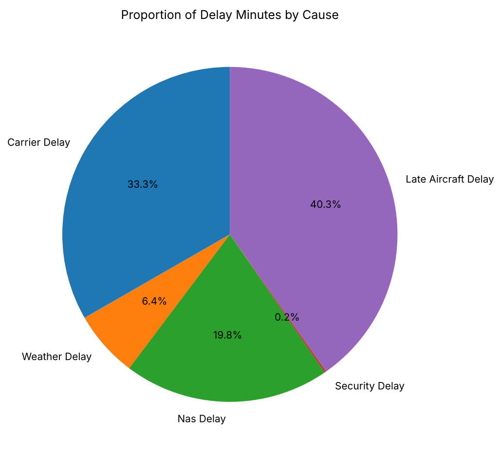
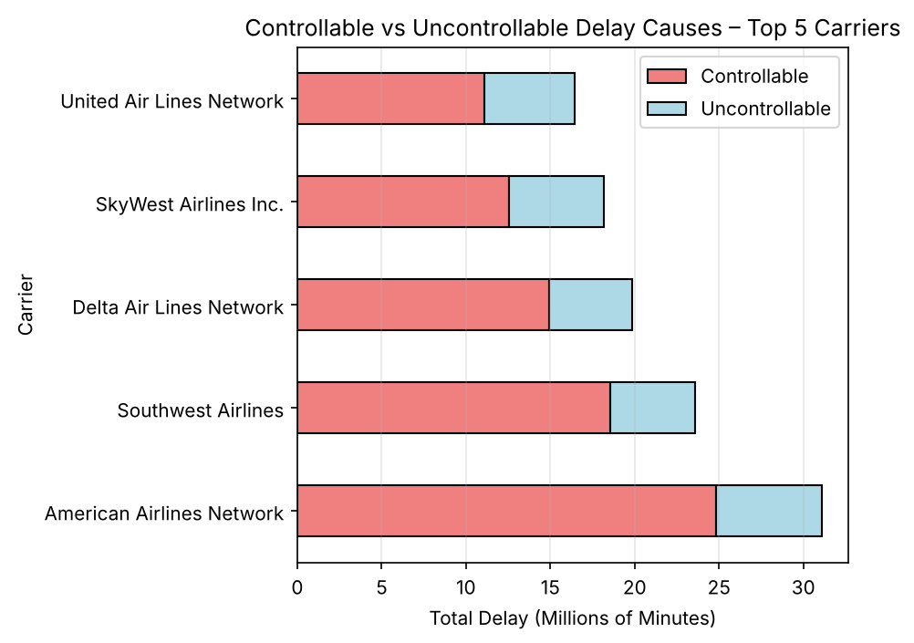

# Airline Delay Analysis

An exploratory analysis of which delay causes, carriers, airports and months account for the most arrival delay minutes across the US airline network, January 2024 to June 2025.

**Tools:** Python, pandas, NumPy, matplotlib, seaborn, Jupyter\
**Notebook:** [notebooks/airline_delay_analysis.ipynb](notebooks/airline_delay_analysis.ipynb) ([view in nbviewer](https://nbviewer.org/github/rahat28ahmed/airline-delay-analysis/blob/main/notebooks/airline_delay_analysis.ipynb))

## Key Results

- Late-aircraft and carrier delays are the two largest causes, at 40.3% and 33.3% of cause-attributed delay minutes. NAS (air traffic system) delays make up 19.8%.
- Total arrival delay correlates most strongly with the number of delayed flights (r = 0.971), late-aircraft delay (0.964) and carrier delay (0.953), then flight volume (0.886), NAS (0.858) and weather (0.801). Security delay is weaker (0.486).
- Delay minutes are concentrated at the largest carriers and hub airports. American Airlines Network records the most (31,109,720 minutes), followed by Southwest, Delta, SkyWest and United. The top airports are DFW, ORD, ATL, DEN and CLT.
- National delay rises and falls sharply from month to month. Small regional airports such as St. Cloud and Adak Island have the most stable monthly delay levels.





## Question

Which causes make up most of the arrival delay minutes, which carriers and airports those minutes sit with, and how much does national delay move from month to month?

## Data

- Source: US Bureau of Transportation Statistics (BTS), [Airline On-Time Statistics and Delay Causes](https://www.transtats.bts.gov/OT_Delay/OT_DelayCause1.asp).
- 34,016 records and 21 variables, each record being one carrier at one airport in one month.
- Main variables: `arr_delay` (total arrival delay minutes), the five cause fields that add up to it (`carrier_delay`, `weather_delay`, `nas_delay`, `security_delay`, `late_aircraft_delay`), `arr_flights`, `arr_del15`, carrier, airport, year and month.
- BTS data is US Government public-domain data, so it is included in `data/Airline_Delay.xlsx` with credit to BTS. See [data/README.md](data/README.md).

## Approach

1. Checked the structure, data types, missing values and duplicates. The 19 to 27 gaps in each measure column were filled with the column median (the text columns had none), and 3 duplicate rows were removed, leaving 34,013 records.
2. Summarised the distribution of `arr_delay`, which is strongly right-skewed, and the mean and spread of each delay cause.
3. Drew a Pearson correlation heatmap of flight volume, delayed flights and the cause fields.
4. Charted the share of delay minutes by cause, the average delay per flight by carrier, controllable (carrier and late aircraft) against uncontrollable (weather, NAS and security) delay for the five carriers with the most delay, the month-on-month change in national delay, and an airport stability measure (the mean absolute month-to-month change in delay minutes).
5. Re-checked missing values, shape and summary statistics after cleaning.

## Limitations

- `arr_delay` is the sum of the five cause fields, so each cause correlates with it partly by construction. The shares of delay minutes are the clearer evidence of which causes matter most.
- Totals are not adjusted for traffic volume except in the delay-per-flight chart, so large hubs rank highly partly because they handle more flights (flight volume alone correlates at r = 0.886).
- The stability measure uses absolute minutes, so the smallest airports look most stable mainly because they have few delays. It also groups records by calendar month, combining the same month in 2024 and 2025.
- Treating late-aircraft delay as controllable is a judgement, not a BTS category.
- A few carriers appear under two versions of their name, which splits their records in the per-carrier charts.

## Repository Structure

```
airline-delay-analysis/
  README.md
  requirements.txt
  LICENSE
  notebooks/airline_delay_analysis.ipynb
  data/Airline_Delay.xlsx
  data/README.md
  figures/
```

## How to Run

```bash
python -m venv .venv
source .venv/bin/activate        # Windows: .venv\Scripts\activate
pip install -r requirements.txt
pip install notebook
jupyter notebook notebooks/airline_delay_analysis.ipynb
```

The dataset is already in `data/`; the notebook reads it from `../data/Airline_Delay.xlsx`.

## Context

Completed as coursework for Business Data Mining and Visual Analytics (COMP1943), MSc Business Analytics, University of Greenwich, 2025–26.
